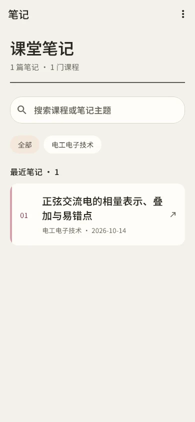
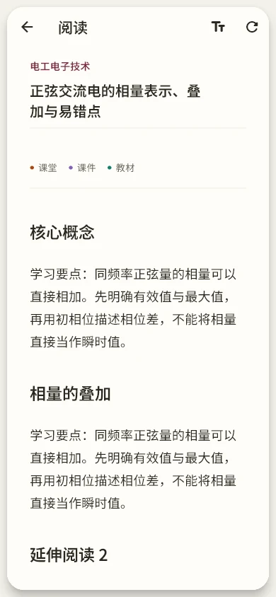
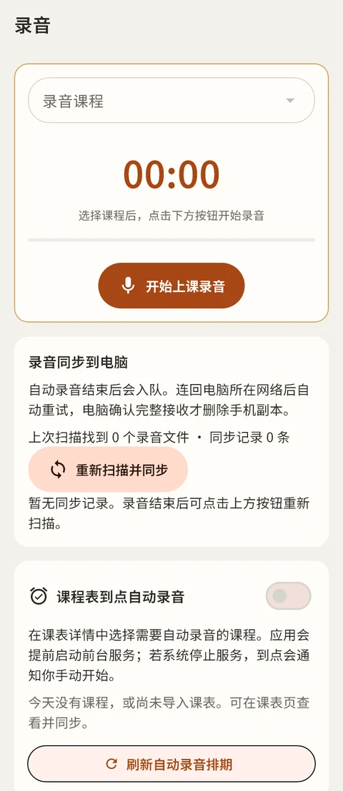
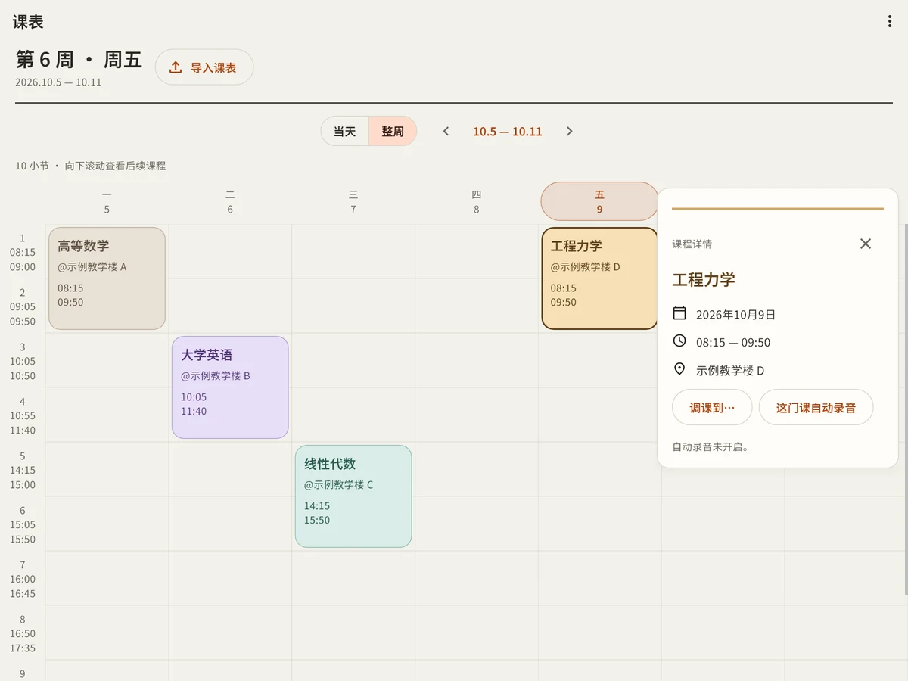

<p align="center">
  
</p>

<h1 align="center">remember</h1>

<p align="center"><strong>课表、课堂录音和笔记，都有一个可以回来的地方。</strong></p>

<p align="center">Android · Windows &nbsp; | &nbsp; 当前版本 1.0.1</p>

remember 是一款面向课堂学习的工具：在手机上查看课程、记录上课内容，回到电脑后同步录音并转写，再把笔记带在身边。它将课表、录音和阅读放在同一套工作流里，让复习时更容易找到需要的内容。

## 界面预览

以下图片由实际 Flutter 界面渲染，使用虚构的演示数据；不同设备的画面可能略有差异。

| 课堂笔记 | 笔记阅读 | 课堂录音 |
| :---: | :---: | :---: |
|  |  |  |
| 按课程查找和打开笔记 | 在手机上阅读整理后的内容 | 选择课程开始录音，并查看同步状态 |

**Windows 课表：**当天和整周视图可以切换，点击课程查看详情或安排自动录音。

<p align="center"></p>

## 能做什么

- **课表**：导入 ICS，在当天和整周视图之间切换；支持教学周、单双周、节次时间和按日期调课。
- **课堂录音**：在 Android 上选择课程手动录音，也可以为课程设置到点自动录音。录音先保存在手机上。
- **录音同步与转写**：手机连回电脑后重试上传，电脑确认完整接收后清理手机副本；Windows 配置并启用 Qwen 后，可将录音转成带时间戳的文本。
- **笔记阅读**：阅读 Markdown、公式、表格和思维导图；保留手机离线阅读入口。
- **两端同步**：电脑与手机在可信局域网内连接。笔记默认从电脑下发到手机，支持每日自动核对和手动核对。
- **日常入口**：Android 课表小组件和课程提醒；Windows 支持可选的开机自启与转写通知。

自动录音需要相应权限和前台服务；小组件及后台行为受设备和系统设置影响。上传、电脑转写和访问电脑文件需要电脑运行且网络可达。

## 开始使用

1. 在 Windows 电脑上运行 remember 及其本机后端。
2. 在电脑端选择「连接手机」，复制连接码。
3. 让手机和电脑连接同一个可信局域网，在手机端输入连接码。
4. 导入课表、选择课程录音，或打开已同步的笔记。

安装包及版本说明见 [Releases](https://github.com/dmbzz/remember/releases)。Android 安装包使用与此前版本相同的签名；设备是否允许覆盖安装仍以实际安装结果为准。

## 从源码运行

```text
app/       Flutter Android / Windows 客户端
server/    FastAPI 后端、配置示例与测试
docs/      图标与项目展示资源
```

客户端使用 Flutter 3.24、Android SDK 34 和 JDK 17；Windows 构建需要 Visual Studio C++ 桌面工具链。在 `app/` 安装依赖后，可运行 `flutter run -d windows` 或 `flutter build apk --release`。

服务端使用 Python 3.13，安装 `server/requirements.txt` 并按配置示例设置数据目录和数据库，然后从 `server/` 运行 `python -m app.main`。使用本地 Qwen 转写时，还需自行准备模型、FFmpeg 和相应运行环境。

提交代码前，请勿上传个人录音、笔记、数据库、访问令牌、签名私钥或 `*.user.*` 本机配置。

## 许可

仓库中的 Apache-2.0 许可仅适用于有权授权的自有代码。字体与第三方依赖各自的许可及尚待完成的审查，见 [THIRD_PARTY_NOTICES.md](THIRD_PARTY_NOTICES.md)。

